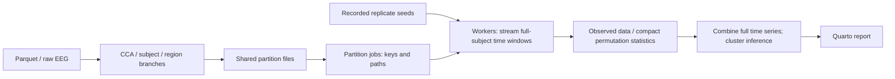

# Partitioned analysis pipeline

`_targets.R` declares a single `partition_sources` registry. Each registered
table has one reusable bundle of files, split by CCA component or brain region.
All analyses consuming that table share the same files. Each bundle includes
a manifest and all data files in its tracked outputs: a missing piece invalidates
its producer. Files are generated under `_targets/user/partitions/`.



## Reusable code

- `R/partitioning.R` handles file bundles, source alignment, deterministic seed
  plans, row-key seeds, worker reads, time-window streaming and batched execution.
- `R/tar_partitions.R` builds the corresponding target graphs. Use
  `tar_partition_registry()` for shared inputs, `tar_partition_target()` for
  observed calculations and `tar_partition_replicates()` for repeated summaries.
  `tar_cluster_permutation()` uses these same primitives for statistics and
  full-series cluster correction.
- `R/tar_mantel.R` composes whole/dynamic ordinary or partial Mantel analyses
  from the same builders. There is no separate ISPS scheduling implementation.

For example, after registering `patterns_indiv_dynamic`, this uses its shared
CCA files, retains every subject in each window and returns only null means:

```r
tar_partition_replicates(
  "summary_isps_dynamic_permuted",
  patterns_indiv_dynamic |>
    mutate(pattern = map(pattern, permute_dist)) |>
    calc_isps() |>
    summarise_isps()
)
```

Sources are found from the registry when the graph is built. Builders replace
registered table references with worker-local pieces, and recognise canonical
`map(pattern, permute_dist)` and Mantel calls to apply the randomisation rules
below. An explicit named `sources` argument can override registry lookup.
Set `stream = FALSE` for observed expressions that must operate across time,
such as selecting a period before collapsing its time column. Joint models
across CCA components remain joint models outside these builders.

## Randomisation and inference

Users do not need to call `set.seed()`. `targets` already seeds every target
and dynamic branch reproducibly. The extra plan serves a different purpose:
coordinating the same randomisation across separately scheduled data pieces,
and keeping replicate draws unchanged when batch boundaries change. Its root
seed comes from `targets::tar_seed_get()` inside an upstream target.
Deterministic observed calculations have no extra seed target or seed reset.
Stochastic Mantel observations and outer replicates retain coordinated seeds.
The same replicate seed is used in every partition/window, so memory-label
shuffles and target-distance shuffles remain shared. Individual pattern shuffles
and inner Mantel simulations use seeds derived from stable row keys. An IGS
dynamic LOO row therefore varies independently by subject/component/time; an RT
whole-period LOO row has no time key and keeps its shuffle across windows.

Batch size, execution order and worker assignment do not change the draws.
RNG kind and sampling kind are explicit. This creates new reproducible draws
relative to historical `tar_rep` caches; Monte Carlo p-values may change.
Partition results retain the complete chronological time series, and cluster
tests run only after those results have been combined.

Outer permutation counts remain 1,000. Mantel still performs 9,999 inner
permutations, explicitly with one inner process. Its outer batches contain
two replicates by default to reduce the work lost if a worker fails. This
changes scheduling granularity rather than the statistical method.

## Coverage and resource policy

CCA-level full-data pattern construction and RT signals are branched by CCA.
Existing subject-wise branches remain parallel. Raw EEG is read once to prepare
region files; whole/dynamic regional patterns are calculated in separate region
jobs. IGS, ISS/IWS, ISPS, GSS/GWS, SMC/partial Mantel, regional analyses and RT
controls use the common partition builders where they consume pattern tables.
Lightweight memory-correlation tables retain whole-table batch parallelism.
RT memory permutations reuse cached IGS/ISS numeric tables instead of recomputing
pattern correlations inside every shuffle. Existing paired resampling and
cross-component prediction/commonality models preserve their joint structure.

Only file preparation runs in the one-worker `heavy` pool. Computations share
11 local workers (24 on SGE); total budgets remain 12/25. Workers read their
own input files once per batch, use transient memory and collect garbage before
each job. One time window's permuted patterns are materialised at a time.
The additional partition files trade disk space and one-time preparation for
smaller worker inputs. This is a concurrency policy, not a hard RAM reservation.

## Validation and operation

`Rscript tests/run_checks.R` checks the compiled graph/report references and
fixed-input equivalence for all calculation families, seed sharing, rebatching,
time clusters, CCA pattern construction and raw-region array handling.

`Rscript tests/smoke_partitioned_pipeline.R` uses generated inputs in a temporary
store. It checks actual workers, reusable files, old-cache migration, mapped
memory outcomes, the Mantel wrapper and deletion/invalidation of a source piece.
`Rscript tests/smoke_real_partitions.R` additionally requires cached project data
and compares three real GWS rows using all 9,999 inner permutations.

Run `targets::tar_make()` normally, or select a final analysis target to validate
one family first. Existing caches need not be deleted. Changed task expressions
and RNG plans invalidate affected results, including some prior permutation
batches. Preserved source targets and unrelated results can still be reused.
Full-run time and machine-wide peak RAM must be measured on the complete run;
more partitions do not reduce the total Mantel permutation count.

## Current-framework real-data checks (2026-11-03)

The shared implementation was separately measured on 206 subjects, three CCA
components and 12 windows, with one permutation per component. The monolithic
reference and partitioned workers used the same keyed random inputs. All 36
ISPS means matched exactly. The reference calculation took 47.75 seconds;
three concurrent workers' calculation interval was 22.03 seconds. Largest
individual-process peak working sets were 2.27 GiB and 0.66 GiB respectively.
The partitioned pipeline took 45.34 seconds including its startup/loading
overhead; that total is not directly comparable to reference compute time.

A separate single-process IGS check loaded both full-component inputs for all
206 subjects and 52 windows, then ran two permutations in one batch. It returned
104 statistic rows in 13.57 seconds, with a 2.62 GiB peak working set. These are
individual-process measurements, not aggregate RAM bounds for eleven workers.
The actual-data GWS smoke test also matched the monolithic calculation at
three components, one window and the full 9,999 inner permutations.

These pilots used temporary stores and read existing caches; they did not run
the complete analysis or update its computed results.
