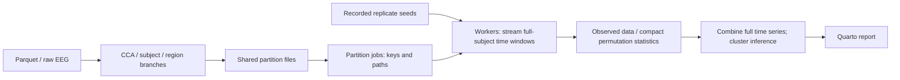

# Partitioned analysis pipeline

`_targets.R` declares a single `partition_sources` registry. Each registered
table has one reusable bundle of files, split by CCA component or brain region.
All analyses consuming that table share the same files. Each bundle includes
a manifest and all data files in its tracked outputs: a missing piece invalidates
its producer. Files are generated under `_targets/user/partitions/`.



## Reusable code

- `R/tar_runtime.R` configures local/SGE workers, environment variables, memory
  resources and logs. `tar_source()` loads it along with the other R functions;
  `_targets.R` then calls `configure_targets_runtime()`. Loading the module alone
  only defines functions and does not configure controllers.
- `R/partitioning.R` handles file bundles, source alignment, deterministic seed
  plans, row-key seeds, worker reads, time-window streaming and batched execution.
- `R/tar_partitions.R` builds the corresponding target graphs. Use
  `tar_partition_registry()` for shared inputs, `tar_partition_target()` for
  observed calculations and `tar_partition_replicates()` for repeated summaries.
  `tar_cluster_permutation()` uses these same primitives for statistics and
  full-series cluster correction.
- `R/tar_mantel.R` composes whole/dynamic ordinary or partial Mantel analyses
  from the same builders. There is no separate ISPS scheduling implementation.

For example, after registering `patterns_indiv_dynamic`, this uses its shared
CCA files, retains every subject in each window and returns only null means:

```r
tar_partition_replicates(
  "summary_isps_dynamic_permuted",
  patterns_indiv_dynamic |>
    mutate(pattern = map(pattern, permute_dist)) |>
    calc_isps() |>
    summarise_isps()
)
```

Sources are found from the registry when the graph is built. Builders replace
registered table references with worker-local pieces, and recognise canonical
`map(pattern, permute_dist)` and Mantel calls to apply the randomisation rules
below. An explicit named `sources` argument can override registry lookup.
Set `stream = FALSE` for observed expressions that must operate across time,
such as selecting a period before collapsing its time column. Joint models
across CCA components remain joint models outside these builders.

## Randomisation and inference

Users do not need to call `set.seed()`. `targets` already seeds every target
and dynamic branch reproducibly. The extra plan serves a different purpose:
coordinating the same randomisation across separately scheduled data pieces,
and keeping replicate draws unchanged when batch boundaries change. Its root
seed comes from `targets::tar_seed_get()` inside an upstream target.
Deterministic observed calculations have no extra seed target or seed reset.
Stochastic Mantel observations and outer replicates retain coordinated seeds.
The same replicate seed is used in every partition/window, so memory-label
shuffles and target-distance shuffles remain shared. Individual pattern shuffles
and inner Mantel simulations use seeds derived from stable row keys. An IGS
dynamic LOO row therefore varies independently by subject/component/time; an RT
whole-period LOO row has no time key and keeps its shuffle across windows.

Batch size, execution order and worker assignment do not change the draws.
RNG kind and sampling kind are explicit. This creates new reproducible draws
relative to historical `tar_rep` caches; Monte Carlo p-values may change.
Partition results retain the complete chronological time series, and cluster
tests run only after those results have been combined.

Outer permutation counts remain 1,000. Mantel still performs 9,999 inner
permutations, explicitly with one inner process. Its outer batches contain
two replicates by default to reduce the work lost if a worker fails. This
changes scheduling granularity rather than the statistical method.

## Coverage and resource policy

CCA-level full-data pattern construction and RT signals are branched by CCA.
Existing subject-wise branches remain parallel. Raw EEG is read once to prepare
region files; whole/dynamic regional patterns are calculated in separate region
jobs. IGS, ISS/IWS, ISPS, GSS/GWS, SMC/partial Mantel, regional analyses and RT
controls use the common partition builders where they consume pattern tables.
Lightweight memory-correlation tables retain whole-table batch parallelism.
RT memory permutations reuse cached IGS/ISS numeric tables instead of recomputing
pattern correlations inside every shuffle. Existing paired resampling and
cross-component prediction/commonality models preserve their joint structure.

Only file preparation runs in the one-worker `heavy` pool. Computations share
12 local workers (32 on SGE); total budgets are 13/33. Workers read their
own input files once per batch, use transient memory and collect garbage before
each job. One time window's permuted patterns are materialised at a time.
The additional partition files trade disk space and one-time preparation for
smaller worker inputs. This is a concurrency policy, not a hard RAM reservation.

The local setting targets the i7-12700F workstation (12 physical cores, 20
logical processors, 63.75 GiB usable RAM). On 2026-11-05, eleven active R
workers used approximately 0.77–0.86 GiB private memory each, with 38.45 GiB
system memory available. Earlier real-data tests reached 2.62 GiB for one
paired-input computation; twelve such workers would use about 31.4 GiB,
before preparation, the scheduler and other applications. This is a planning
estimate, not an upper bound. Twelve compute workers match the physical-core count
while retaining CPU headroom; twenty compute workers would be too aggressive as
a default given heterogeneous task memory and the history of resource errors.

Before launching workers, `configure_targets_runtime()` sets `OMP_NUM_THREADS`,
`OPENBLAS_NUM_THREADS`, `MKL_NUM_THREADS` and `RCPP_PARALLEL_NUM_THREADS` to one.
These limit supported library thread pools, including Arrow's CPU pool via
OpenMP's environment setting; they do not pin CPU cores or cap total process
threads. `EEG_WORKERS` accepts a positive integer
to override the local compute count. Existing running controllers retain their
original settings. Twelve is a conservative operating default following the
full-run startup failure described below. The earlier 11/14/16-worker benchmark
does not establish long-run reliability or a global throughput optimum.

### SGE scheduling (2026-11-05)

The SGE compute pool now defaults to 32 workers, with one additional worker for
full-input file preparation. `EEG_SGE_WORKERS` can raise/lower the compute count
without changing the local `EEG_WORKERS` setting. Hostname detection ignores case
for `shadow` and `hippocampus`. Each job is serial (one SGE slot), avoiding an
assumption about the cluster's parallel-environment name. Queue/host eligibility
and user quotas determine how many jobs can actually run; `qhost` alone cannot
establish those permissions or allocations.

Compute workers request 6 GB each; the preparation worker requests 24 GB. Before
creating controllers, `qconf -sc` is inspected for requestable MEMORY
resources. The default preference is `m_mem_free`, then `mem_free`. An explicit
`EEG_SGE_MEMORY_RESOURCE` selects a registered custom resource with those same
properties and `relop <=`. Missing resources cause an error before job submission.
The request is written
as `#$ -l RESOURCE=6G` or `24G`; its enforcement depends on the site's SGE complex
configuration. It is not an independently imposed process memory cap.

The user's actual complex table has `mem_free` with `consumable=NO`, and no
`m_mem_free`. Thus `mem_free=6G`/`24G` selects hosts by current free-memory load;
it does not reserve that amount for each job. When the chosen resource is not
consumable, the default additional requirement is `mem_total=400G`. In the supplied
qhost snapshot this selects `cogmap` and `schema` (503.4 GB each), rather than
allowing 32 compute workers to accumulate on smaller, already busy hosts.
This reduces placement risk but does not exclude competing users or reserve a
node. If the user's queue cannot reach those hosts, jobs remain pending instead
of falling back to small hosts. `EEG_SGE_MIN_HOST_GB` overrides the floor; zero
disables it. A consumable-memory resource defaults to no host-size restriction.
True memory reservations require an administrator-configured consumable resource.

SGE scripts explicitly export the same thread and renv sandbox settings as local
workers, because SGE does not forward submission-shell variables by default.
Scripts and per-job joined stdout/stderr logs use shared project directories
`logs/crew/sge/{light,heavy}/`, with scripts in the `scripts/` subdirectory.
Idle workers remain available for up to 300 seconds rather than 30, reducing
repeated environment startup. The SGE controller's default 24-hour launch grace
is retained to accommodate queue waiting; the local 120-second allowance does not
apply to queued jobs. No remote jobs are submitted by the local configuration
checks. Verify queue access and observed per-worker peaks before increasing to
48 or 64 compute workers.

Validation used `qconf -sc` fixtures for consumable resources and the user's
nonconsumable-memory layout, including the 400G host filter and invalid overrides.
A simulated SGE configuration rendered actual
crew.cluster 0.4.0 job headers for both pools and verified 32/1 worker limits,
6G/24G thresholds, the 400G host filter, explicit exports, joined per-job logs, no parallel-environment
request, a 300-second idle timeout and the default queued-launch grace. This did
not execute qsub or establish remote queue eligibility. The local graph/report
check continued to pass with 824 targets and 95 report references.

The memory fields, environment forwarding and logging follow
[the crew.cluster SGE options](https://wlandau.github.io/crew.cluster/reference/crew_options_sge.html).

### Full-run startup failure and mitigation (2026-11-05)

After a reported failure following 39 completed targets, inspection found 482
remaining Rscript crew workers, about 48.25 GiB aggregate private memory, all
from one controller (parent PID 16056, loopback port 62405). Neither the parent
nor its listening socket still existed. Recent worker logs reported connection
refusal and a renv sandbox activation warning of approximately 2,900 seconds.
By the cleanup snapshot, 474 workers remained; those verified orphan processes
were terminated, leaving none from that controller. Formal cached results were
not deleted. The main-process exit cause was not recorded and is not established.

Slow worker startup followed by repeated replacement launches is a plausible
explanation for the accumulation; 14 concurrent calculations alone do not
explain hundreds of processes. Local controllers now allow 120 seconds for
startup (previously the default 30). New workers inherit
`RENV_CONFIG_SANDBOX_ENABLED=FALSE`, skipping renv's additional sandbox for
system-library packages while retaining project activation and the project
library. This makes non-base packages in the system library potentially visible
as a fallback; the verification probe checks project-library resolution for the
packages it uses. No package installation or lockfile change is involved.

[renv documents disabling the sandbox when its initialization is slow](https://pkgs.rstudio.com/renv/reference/config.html),
and [crew documents the startup grace period](https://wlandau.github.io/crew/reference/crew_controller_local.html).
The default compute pool is reduced to 12 as a separate stability precaution.
An isolated startup probe brought all twelve workers to a synchronised ready
state in 22.8 seconds, verified package paths against the project library and
versions against `renv.lock`, and confirmed Arrow's CPU pool remained single
threaded. All probe workers terminated afterward. The graph/report check still
passed with 824 targets and 95 report references; the complete pipeline was not
restarted by the probe.

### Workstation worker benchmark (2026-11-05)

The full pipeline was stopped for this comparison. Each configuration ran the
same 112 tasks: two ordinary Mantel tests per task, 9,999 inner permutations,
using cached real GWS distances for one CCA component, one time window and
150 stimuli, against `pattern_shapes_alexnet_conv2d_4_9`. Per-task seeds were
fixed across configurations. A file barrier required every worker to finish
loading vegan and its warmup calculation before timing began. Actual worker
PIDs were checked against the configured count. Timing includes task submission,
collection and memory sampling, and excludes process launch and warmup.

| Compute workers | Actual workers | Elapsed seconds | Mantel tests / second | Sampled aggregate worker RSS (GiB) |
| --- | --- | --- | --- | --- |
| 11 | 11 | 74.25 | 3.017 | 3.64 |
| 14 | 14 | 69.16 | 3.239 | 4.38 |
| 16 | 16 | 70.12 | 3.195 | 4.96 |

All 224 p-values matched exactly across configurations. Fourteen and sixteen
workers performed similarly in this bounded benchmark; fourteen took 6.8% less
time than eleven and retained more memory/CPU headroom than sixteen. This supports
fourteen as a provisional balanced default at that time, not proof of a universal
optimum; the subsequent failure superseded that recommendation. The RSS figures
describe this small-distance Mantel benchmark, not the larger IGS inputs or a
full-pipeline memory bound. Preparation ran neither concurrently nor inside the
timed interval. Earlier exploratory runs without the all-worker warmup barrier
were variable; one configured eleven-worker run used only five workers and was
excluded from the decision.

## Validation and operation

`Rscript tests/run_checks.R` checks the compiled graph/report references and
fixed-input equivalence for all calculation families, seed sharing, rebatching,
time clusters, CCA pattern construction and raw-region array handling.

`Rscript tests/smoke_partitioned_pipeline.R` uses generated inputs in a temporary
store. It checks actual workers, reusable files, old-cache migration, mapped
memory outcomes, the Mantel wrapper and deletion/invalidation of a source piece.
`Rscript tests/smoke_real_partitions.R` additionally requires cached project data
and compares three real GWS rows using all 9,999 inner permutations.

Run `targets::tar_make()` normally, or select a final analysis target to validate
one family first. Existing caches need not be deleted. Changed task expressions
and RNG plans invalidate affected results, including some prior permutation
batches. Preserved source targets and unrelated results can still be reused.
Full-run time and machine-wide peak RAM must be measured on the complete run;
more partitions do not reduce the total Mantel permutation count.

## Current-framework real-data checks (2026-11-03)

The shared implementation was separately measured on 206 subjects, three CCA
components and 12 windows, with one permutation per component. The monolithic
reference and partitioned workers used the same keyed random inputs. All 36
ISPS means matched exactly. The reference calculation took 47.75 seconds;
three concurrent workers' calculation interval was 22.03 seconds. Largest
individual-process peak working sets were 2.27 GiB and 0.66 GiB respectively.
The partitioned pipeline took 45.34 seconds including its startup/loading
overhead; that total is not directly comparable to reference compute time.

A separate single-process IGS check loaded both full-component inputs for all
206 subjects and 52 windows, then ran two permutations in one batch. It returned
104 statistic rows in 13.57 seconds, with a 2.62 GiB peak working set. These are
individual-process measurements, not aggregate RAM bounds for twelve workers.
The actual-data GWS smoke test also matched the monolithic calculation at
three components, one window and the full 9,999 inner permutations.

These pilots used temporary stores and read existing caches; they did not run
the complete analysis or update its computed results.
